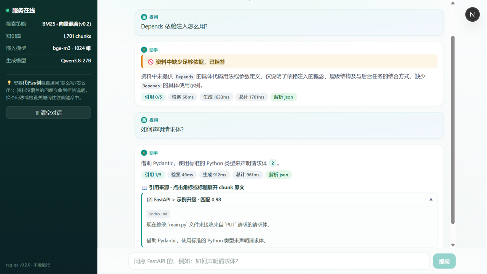

# rag-qa · FastAPI 中文文档问答系统

基于官方 FastAPI 中文文档(122 篇)的检索增强问答:混合检索(BM25 + 向量)定位段落,
LLM 依据资料作答并逐句标注引用,资料不足时诚实拒答而非编造。

> Agent 应用开发备考 · 项目 1(对应 `agent-internship-plan.md` Week 1~2)

**最终版本 v0.10-top8**:200 题 × 3 轮全量实测,正确性 4.81/5、误拒率 **0.00%**、
无法回答题正确拒答率 **100%**、安全作答率 100%、faithfulness 95.0%,平均端到端 **2.08s/题**。
生成 DeepSeek-V4.1-Flash,判分固定 qwen3.8-27b;逐轮记录见
[`eval/results-deepseek.md`](eval/results-deepseek.md)。

> 更快的旧组合:`TOP_K=5` + `RETRY_REWRITE=false`(v0.9-inference)为 4.72 / 1.04% / 99.2% / 1.62s。
> 默认配置(k=8 + 定向改写)用 +0.46s 换到零误拒、100% 正确拒答、4.81 正确性;三个开关都可在 `.env` 切换。

## 文档

- **[文档地图](docs/README.md)**:按角色选阅读路径(面试/开发/接手)
- **[版本历史](CHANGELOG.md)**:每个版本改了什么、指标、tag、判决
- **[工程复盘](notes/engineering-story.md)**:误拒 7.9% → 0 的度量设计、迭代、负结果与面试问答(推荐)
- **[全部跑批记录](eval/results-deepseek.md)**:200 题 × 3 轮、第二 judge 复判、60 题留出集

## 架构

```
用户提问
   │
   ▼
┌─ 检索(v0.2-hybrid,单题 <0.3s)──────────────────┐
│  bge-m3 向量 top-20 ─┐                           │
│                      ├─ RRF 融合 → top-5 chunk   │
│  BM25 中文bigram+代码词 ┘                         │
└──────────┬────────────────────────────────────┘
           ▼
┌─ 生成(OpenAI 兼容 API,如 DeepSeek)─────────────┐
│  编号上下文 → 严格 JSON {answer, citations,      │
│  refused};解析失败重试 1 次 → 安全拒答           │
└──────────┬────────────────────────────────────┘
           ▼
  回答 + 引用卡片(可展开 chunk 原文) 或 拒答说明
```

- **语料管道**:md 加载 → 占位符还原真实代码(439 处)→ 清洗 → 标题感知切块(512/50)
  → 1701 chunk 入 Chroma;不变量 `chunk.text == full_text[char_span]` 全库校验
- **评估体系**:200 题测试集(事实 100 / 推理 60 / 无法回答 40,gold chunk 标注),
  recall@5 双口径 / MRR / judge 正确性 / faithfulness 拆 claim / 拒答率分口径统计,
  另设"无检索直接问答"对照列证明 RAG 增益

## 快速开始(本地运行)

```bash
# 1) 环境(Python 3.13)
python -m venv .venv
.venv\Scripts\activate           # Windows;Linux/macOS 为 source .venv/bin/activate
pip install -r requirements.txt
pip install -r requirements.lock # 可复现安装:锁版本(全新 venv 装 txt 验证 94 例全绿后 freeze 而来;pywin32 带 win32 平台标记)

# 2) 配置:LLM 指向 OpenAI 兼容 API(DeepSeek 示例见 .env.example);模型缓存指到本机有空间的盘
cp .env.example .env             # 填 LLM_API_KEY,并把 HF_HOME 改成本机实际路径

# 3) 模型与索引(仅首次;data/chroma/ 不入库,新环境要重建)
python scripts/download_models.py --embed   # bge-m3 ~2.1GB,走 hf-mirror
python scripts/build_index.py               # 122 篇 md → 1701 chunk → Chroma(CPU 约 6min)

# 4) 起服务
python -m uvicorn app.api:app --port 8000   # API:http://localhost:8000/docs
cd web && npm install && npm run dev        # 正式前端 :http://localhost:3000(Next.js,SSE 流式 + 引用溯源,详见 web/README.md)
```

说明:生成依赖 OpenAI 兼容 API(DeepSeek/自建 vLLM 均可,地址见 `.env` 的 `LLM_BASE_URL`);检索/嵌入完全本地——LLM 不通时
/health 仍正常、/ready 报 `llm_ready:false`、/ask 返回 502(客户端只见脱敏文案+追踪 id,
细节在服务端日志)。单测:`pytest`(94 个 = 离线 92 + 依赖真实索引的 MCP 协议 2,后者在无索引
环境自动跳过;CI 在 ubuntu 上跑同一套。系统临时目录的 `pytest-of-*` 子树不可用的受限环境会
自动回落到项目内目录)。

Docker 齐备的部署文件(Dockerfile/docker-compose.yml)留档在库备用,本地运行用不上。

## 界面



`web/`(Next.js 16 + React 19 + Tailwind v4)为正式前端:SSE 流式打字机渲染、答案内 `[n]` 角标
点击展开 chunk 原文(文档名 + 路径 + 相似度)、拒答盒、侧栏服务状态轮询;与 Streamlit 原型对齐视觉、
交互升级为流式(原 `app/ui.py` 已删除,历史版本见 git)。结构详见 `web/README.md`。

## 版本演进与评估(200 题全量真实跑批)

### Qwen 答题 / Qwen 判题(v0.1~v0.5)

| 版本 | 正确性 | 误拒率 | 正确拒答率 | chunk recall@5 | 延迟代价 | 判决 |
|---|---|---|---|---|---|---|
| v0.1-baseline 纯向量 | 3.92 | 18.1% | 97.5% | 64.4% | — | 基线 |
| **v0.2-hybrid BM25+RRF** | **4.41** | **7.5%** | **100%** | **83.1%** | +0.1s | Qwen 时代定版 |
| v0.3-rerank CrossEncoder 精排 | 4.49 | 5.6% | 97.5% | 90.0% | +6.3s/题 | CPU 不划算,留 GPU 场景 |
| v0.4-rewrite 多查询扩展 | —(检索层出局) | — | — | 74.4% | +1.8s/题 | 变体共识稀释排序,负结果 |
| v0.5-chunking 三案对比 | 持平 | — | — | 94~96%(doc 口径) | — | 切块非瓶颈,负结果 |

### DeepSeek 答题 / Qwen 判题(v0.6~v0.9,判分模型固定)

| 版本 | 正确性 | 误拒率 | 正确拒答率 | chunk recall@5 | 延迟代价 | 判决 |
|---|---|---|---|---|---|---|
| v0.6 换生成模型(三轮均值) | 4.350 | 7.9% | 96.7% | 83.1% | — | 基线 |
| v0.7-retry20 误拒兜底(三轮均值) | 4.610 | 1.25% | 95.0% | 83.1% | +0.18s/题 | 上一版定版 |
| v0.9-inference 推理 prompt(三轮均值) | 4.717 | 1.04% | 99.2% | 83.1% | +0.11s/题 | ✅ 保留 |
| v0.9-rewrite 定向改写(三轮均值) | 4.767 | 0.00% | 97.5% | 83.8%* | +0.57s/题 | 上一版定版 |
| **v0.10-top8 首轮 k=5→8(三轮均值)** | **4.815** | **0.00%** | **100%** | 83.8%* | −0.12s/题 | **✅ 定版** |

> *v0.9-rewrite 起的 recall@5 与前几版不可直接比:被改写题目的命中列表是"改写 10 条 + 原 10 条"
> 的合并列表,0.838 是这条列表的前 5 名,不是原始检索 top-5。v0.10 的 k=8 不改变这个口径。

关键读数:

- **v0.1 的教训**:doc 口径 recall 87.5% 但 chunk 口径仅 64.4%——找对文档、找不到段落;
  29 道误拒里 28 道根因是 gold chunk 没进 top-5(检索没送到,不是模型不会)
- **v0.2 一轮吃掉大头**(+0.49 正确性);v0.3 检索层再 +6.9pp 但端到端只 +0.08
  ——排序增益对"top-5 已够用"的生成是冗余的
- **推理题翻身**:v0.1 时被检索拖累(3.66 vs 裸模型 4.17),v0.2 追平(4.12);
  事实题 RAG 增益 +0.87
- **拒答机制**:分数阈值闸门原理性失效(无法答题 top-1 匹配分中位 0.94,与可答题分布
  重叠),LLM 内容级拒答支配全阈值曲线,维持自主拒答(`eval/calibration.md`)
- **v0.7 误拒兜底**:首轮判拒后用 `retry_k=20` 再次检索、扩大上下文重答一次,
  误拒率 7.9% → **1.25%**(三轮都只有 2/160,题集完全相同);代价是正确拒答率
  96.7% → 95.0%、平均 +0.18s/题(仅拒答路径多一次生成,检索深度本就是 20 条)
- **剩下的最后一公里**:2 道误拒题 gold 在 20 名外(查询改写/rerank 才能救);
  `fact-082`/`reas-027` 是"答得出但判分低",属于生成质量而非拒答问题
- **v0.9 推理 prompt**:允许"资料覆盖所需全部事实、仅结论需一步对比/归纳"时作答并标注推断,
  但"具体写法/参数/步骤/库名不存在"必须拒答。推理题 4.33 → 4.54、误拒 1.04%、正确拒答 99.2%;
  代价 faithfulness 97.1% → 95.1%(推断句被判"无依据声明")、+0.11s/题
- **v0.9 定向改写**:只对"两次都拒"的题触发,把 `fact-049` 的 gold 从 20 名外拉回第 2 名,
  误拒 1.04% → **0.00%**;代价是约 21% 的请求多一次改写 + 一次生成(被改写题 4.2~5.5s、
  全量 +0.57s/题),正确拒答 99.2% → 97.5%(被改写的无法回答题变成"有依据的部分作答",
  安全率仍 100%)。不想要延迟就设 `RETRY_REWRITE=false`
- **v0.10 首轮 k=8**:离线统计 160 道可答题的 gold 排名,133 道在 ≤5、**12 道在 6~8**、4 道在 9~10;
  取 k=8 后 `fact-077` 3.3→5.0、`fact-079` 1.0→4.7、`reas-059` 1.7→4.7,正确性 4.767 → **4.815**,
  正确拒答 97.5% → **100%**,延迟反而 −0.12s(更多题首轮直接答出,少走二次/改写);
  代价是个别题被多出的上下文干扰(`reas-023` 4.3→3.0 等),但净收益为正

评估可信度:judge 与独立第三方模型盲评对比,±1 分一致率 100%(24/24),Pearson 0.886,
误拒样本被双方独立同判;v0.10 又用 glm-5.3 复判三轮 457 条,完全一致 91.5%、±1 一致 99.8%、
仅 1 条差 ≥2 分。完整数据见 [`eval/results.md`](eval/results.md),原始记录留档 `eval/runs/`。

**性能(流式,50 题采样,默认配置)**:首字延迟(TTFT)p50 **677ms** / p90 967ms;
端到端 p50 1478ms / 均值 1982ms——长尾来自拒答题(二次检索 + 改写 + 三次生成,单题 4~5s)。
复现:`.venv\Scripts\python.exe -X utf8 -m eval.bench_latency --n 50`。

**泛化检验**:另出的 60 道留出题(200 题未覆盖的段落,独立模型审核,未参与调参)三轮
正确性 **4.9444 ± 0.0098**、误拒 0、正确拒答 100%、安全率 100%;题目偏直接抽取,不能替代更难的基准,
明细见 [`eval/results-deepseek.md`](eval/results-deepseek.md)。

**工程复盘**:从 7.9% 到 0 的完整过程、两个负结果与面试问答整理在
[`notes/engineering-story.md`](notes/engineering-story.md)。

## 踩坑 Top 3

1. **rank-bm25 0.2.2 + NumPy 2.x 静默返回全 0 分**——`get_scores()` 对明显命中的查询
   返回全零且不报错。最小复现确认后自实现 30 行 Okapi BM25(倒排表)。
   教训:第三方"标准库"也要冒烟验证再信。
2. **HF_HOME 不生效,2.1GB 模型下到 C 盘**——直接 import sentence_transformers 的脚本
   没先应用项目配置,HF_HOME 落空走默认路径。教训:环境变量型配置必须在 import 模型库
   之前应用;重模型脚本先 10 题实测耗时再全量。
3. **多查询 RRF 平权融合被变体共识稀释**——3 个 LLM 变体对"相关但不准"chunk 的共识分
   轻松压过原查询第一名,recall 反降 8.7pp。教训:多路融合必须明确"谁有否决权";
   小样本(10 题)探测只能判断耗时,质量结论必须全量。

## 目录

```
app/        检索(hybrid/rerank/rewrite/parentchild 开关)· 生成 · 编排 · API · UI · MCP server
pipeline/   语料加载 / 清洗 / 切块 / 嵌入 / 入库
eval/       出题 · 预筛 · 跑批 · 指标 · 校准 + results.md / calibration.md
data/       语料 / chunk / Chroma / 评估产物(模型缓存不入库)
tests/      94 个单测(离线 92 + 真实索引 MCP 协议 2,CI 上自动跳过)
```

## MCP 工具设计(项目 4 Day 24,官方 SDK `mcp` 2.x,stdio transport)

设计原则与 chatbi 的数据库查询 server 一致:**MCP 是工具的传输协议,不改工具的语义**。
`app/mcp_server.py` 直接复用 `get_retriever()` 的混合检索栈(模式随 .env 的
`RETRIEVER`,默认 hybrid,含 manifest 索引校验),RAG 生成(编号上下文、引用、
拒答)留在客户端。

| 原语 | 定义 | 谁来调用 | 为什么用它 |
|---|---|---|---|
| **tools** | `search(query, top_k≤10)` | 模型,带参数 | 编号 chunk 列表,编号口径与主链路 `build_context` 一致,客户端直接沿用引用纪律 |
| **resources** | `rag-qa://corpus` | 客户端,按 URI 读 | 索引/语料统计(manifest 同源:检索模式、chunk 数、文档清单,数值随索引重建更新),静态上下文不占工具轮次 |
| **prompts** | `answer_with_citations(question)` | 用户主动触发 | "忠于检索内容、编号引用、不足即拒答"的 RAG 纪律模板,与主链路 SYSTEM_PROMPT 同源 |

启动只读配置(秒级),嵌入模型/索引在首次 `search` 才加载(~10s,进程内只付一次)
——Inspector 里 tools/list 即时可见。索引校验失败(manifest 错配)转 `isError=true`
+ 完整诊断消息回传;`top_k` 越界同样以 isError 报告参数边界。

验证(`tests/test_mcp_server.py`,2 例,真实 stdio 子进程):三类原语发现与调用、
参数边界、**3 组 query 经 MCP search 与本地 `retriever.retrieve` 逐字一致**;
Inspector CLI 实测通过(中文 query 命中正确文档,UTF-8 字节干净)。
演示见 chatbi 仓 `scripts/mcp_client_demo.py`:一次会话连两个 server
(chatbi-db + rag-qa-docs),LLM agent 按命名空间路由工具调用。

```bash
# 运行(stdio)与 Inspector 调试
.venv/Scripts/python.exe -m app.mcp_server
npx @modelcontextprotocol/inspector --cli --config scripts/mcp-inspector.json --server rag-qa-docs --method tools/call --tool-name search --tool-arg "query=后台任务怎么用" --tool-arg "top_k=2"
```

## 运行版本开关(.env)

`RETRIEVER=vector|hybrid|rerank|rewrite|parentchild`(默认 hybrid);
rerank 需 bge-reranker-v2-m3(CPU 每题 +6.3s,建议 GPU 环境)。

`RETRY_K=20`(默认;0=关闭):首轮判拒后用更大的 k 二次检索、扩大上下文重答一次。
只走拒答路径(约 8% 流量),流式事件序 `retry → sources → delta*`;误拒修复数字见
[`eval/results-deepseek.md`](eval/results-deepseek.md)。

`RETRY_REWRITE=true`(默认;false=关闭):二次仍拒时让 LLM 把问题改写成检索友好的查询,
k=20 重检索后取"改写前 10 + 原命中前 10"合并、重排引用编号,再生成第三次;流式多一轮
`retry → sources → delta*`。200×3 实测误拒 1.04% → 0,代价 +0.57s/题(只作用于拒答题)。

`TOP_K=8`(默认;需满足 `TOP_K < RETRY_K`,否则启动即报错):首轮检索深度。k=8 让 gold 在
6~8 名的 12 道题首轮就能拿到;设回 5 可回到旧口径(配合 `RETRY_REWRITE=false` 即 v0.9-inference)。
